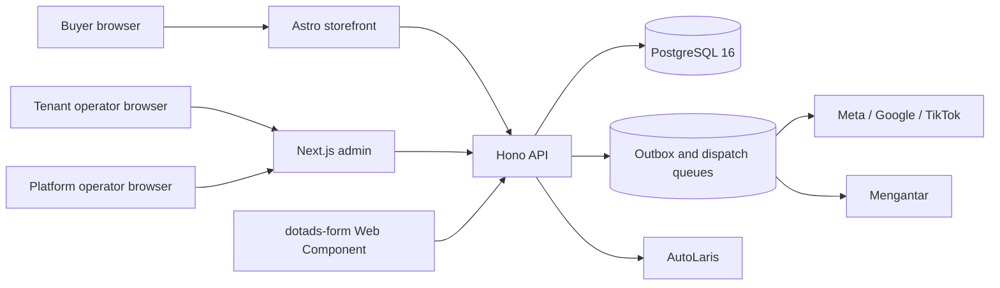

# DotAds Engine v2 — System Architecture

**Document owner:** Engineering Architecture
**Last reviewed:** 2026-08-16
**Release state:** Active remediation; see `STATUS.md`

## Claim Convention

- **Observed** — verified from the current repository or an executable check.
- **Decision** — an approved architecture constraint.
- **Proposal** — target design that is not implemented yet.
- **Unknown** — unresolved and assigned before release.

## System Context

**Observed:** DotAds is a pnpm/Turborepo monorepo with three deployable applications and shared packages.

## Runtime Boundaries

| Boundary | Observed implementation | Authority |
| --- | --- | --- |
| Admin | Next.js App Router under `apps/admin` | Presentation and server-side route gating; never the authorization authority |
| Storefront | Astro 6 static output under `apps/storefront` | Buyer experience and progressive enhancement |
| API | Hono under `apps/api`; `/api/v1/{platform,admin,public,webhooks,workspaces,catalog,members,dashboard}` | Validation, authorization, lifecycle rules, aggregates, and provider boundaries |
| Authentication | Better Auth with Drizzle adapter | Session and organization membership identity |
| Database | PostgreSQL 16 with Drizzle | Persistence, constraints, transactional invariants, and required tenant isolation |
| Form runtime | Native custom element under `packages/form-runtime` | Embeddable form behavior; no price or tenant authority |
| Integrations | `packages/integrations` | Provider request mapping, idempotency, retries, and error classification |

## Trust Boundaries

1. Public inputs are untrusted. Product prices, stock, tenant ownership, payment eligibility, and conversion timing are derived server-side.
2. Admin navigation is usability only. The tenant server layout prevents direct rendering outside role-visible route prefixes, while every API action independently requires an authenticated session, active tenant membership, and a default-deny permission.
3. Webhooks require provider authentication and replay-safe reconciliation before changing business state.
4. Audit evidence is written in the same transaction as sensitive mutations and is append-only at the database boundary.
5. **Observed locally:** migration `0004` enforces forced PostgreSQL RLS through distinct non-owner tenant-runtime and platform-control logins plus transaction-scoped context. Disposable adversarial tests deny cross-tenant access and role escalation. Production credential provisioning and deployment wiring remain a release gate.

## Tenant Resolution

| Request class | Tenant source | Failure behavior |
| --- | --- | --- |
| Tenant admin | Validated Better Auth active organization and membership; a fresh session may recover exactly one active membership; an authenticated user may explicitly select one of at most 100 own active memberships | `401` for missing/invalid session; exact `409 WORKSPACE_SELECTION_REQUIRED` when selection is ambiguous; foreign, inactive, or unavailable selection fails closed; `403` for missing membership or inactive tenant |
| Platform admin | Authenticated global `SUPER_ADMIN` | `403` for every other role |
| Public storefront/form | Verified host/domain or server-validated tenant identifier bound to catalog data | Unknown, inactive, or mismatched tenant fails closed |
| Provider webhook | Verified provider credential/signature plus persisted configuration mapping | Invalid signature or unresolved target is rejected |

**Decision and observed implementation:** tenant-scoped database work executes inside a transaction that sets local request context. Pool-level session variables are forbidden because deployment may use transaction pooling.

**Observed locally:** migration `0005` provides a fixed-search-path, least-privilege session-workspace resolver. It may update only the supplied authenticated user's session, auto-selects only one active membership, and fails closed for ambiguous multi-workspace accounts.

**Observed locally:** migration `0006` adds bounded own-membership listing and explicit active-workspace selection for CMS operator roles only; `END_BUYER` is excluded. The API contract requires `organizationName` so similarly named tenants can be distinguished by organization context, and selection may update only the authenticated user's current session. Fresh-database evidence applied migrations `0000`–`0006` and passed own-workspace listing, forged-selection denial, and persisted/restored selection.

**Observed account-entry flow:** login, registration, and setup return to `/`. The root server dispatcher sends platform operators to `/super-admin`, tenant operators with a valid workspace to `/admin`, and only the exact workspace-selection conflict to the picker. After successful selection the client returns to `/` for server-derived dispatch. Real Chrome over the local Tailscale address verified role separation, picker loading/available/unavailable states, database-backed selection, sign-out, and stale-cookie recovery. The initial sign-out `415 Unsupported Media Type` was caused by omitting the JSON content type/body; the client now sends the Better Auth sign-out request as JSON. A six-role smoke verifies the tenant direct-route guard, while full browser role/accessibility coverage remains open.

**Development-only boundary:** the environment-backed seed command reproducibly creates `admin` / `admin` as a local Super Admin and `merchant` / `merchant` as a local multi-workspace tenant fixture. Both the seed path and login aliases are disabled in production; neither is a production credential contract or release evidence.

## Platform Read Contracts

**Observed:** platform tenants, statistics, and audit events use typed API/client contracts. Statistics expose numeric tenant/order/GMV totals and `securityAlertsCount: null`; the null is intentional until audit records have a defined security classification. The CMS does not infer a security count.

**Observed:** `GET /api/v1/platform/audit-logs` returns `{ items, pagination }`, accepts exact optional `tenantId`, `action`, and `actorId` filters, limits pages to 1–100 rows, and bounds offset at 10,000. Items expose actor and target identifiers plus timestamp, but omit metadata, IP, severity, before/after, retention, and integrity assertions. The database append-only trigger remains separate evidence; the read UI does not elevate that into a completeness claim.

**Observed:** Super Admin overview and audit are read-only consumers of those contracts. Platform settings have no read/write API and render an unavailable state; audit export is disabled. Full tenant provisioning, secure impersonation, configuration writes, and export remain target work.

## Tenant CMS Data Boundaries

**Observed:** `/api/v1/catalog/products` owns bounded tenant list/detail plus transactional create/update/archive. Catalog mutations combine explicit tenant predicates, RLS, database constraints, optimistic tokens, serialized product/variant writes, and bounded before/after audit snapshots. Checkout and Catalog share a product-then-variant lock order and revalidation boundary; the focused interleaving smoke rejects stale checkout without holding database locks during the external shipping-rate lookup.

**Observed:** `/api/v1/members` owns the tenant organization directory and invitation/member mutations. It persists list/invite/resend/cancel/role/remove with transactional audit evidence and last-owner/self guards. Separate `POST /api/v1/invitations/{id}/accept` plus migration `0012` owns real-session/email-bound atomic acceptance. Delivery remains `not_configured`; Chrome covers invite→resend→cancel only, not acceptance or the complete role/remove matrix.

**Observed:** `/api/v1/dashboard` is a tenant-only, `orders:read` aggregate boundary. It rejects platform/no-tenant contexts, declares strict success and `400/401/403/409/500` envelopes, and returns no PII. The admin Dashboard consumes its real 7/30-day WIB buckets and status breakdowns; Chrome verified both periods at desktop/tablet/mobile widths. Live empty/error fixtures and full keyboard order automation remain unverified.

**Observed locally:** migrations `0008`–`0011` add Catalog constraints/parent ownership, pending-invitation uniqueness, monotonic Catalog concurrency tokens, and the Dashboard tenant/date index; `0012` adds invitation acceptance; `0013` narrows the platform database role; `0014` adds unambiguous webhook bindings; and `0015` adds the public-order/prepaid idempotency state machine. PostgreSQL pools force UTC; transaction-local identity/tenant context remains separate.

## Data and Commerce Invariants

- **Decision:** monetary values are integer rupiah. IDR has exponent 0 in this product; provider conversion happens only at an adapter boundary.
- **Decision:** order, payment, and fulfillment are separate state axes. A browser submission is not a Purchase conversion.
- **Decision:** prepaid Purchase is emitted after verified payment; COD Purchase is emitted after verified delivery/cash policy event.
- **Decision:** order intake recomputes totals, reserves/decrements stock atomically, and uses an idempotency key plus a collision-safe tenant order number.
- **Observed:** tenant Orders list/detail use bounded typed API envelopes, canonical order/payment/fulfillment axes, explicit `IDR`, and offset-bearing instants. List rows omit shipping address; detail remains permission- and tenant-scoped.
- **Observed:** processing, cancellation, and dispatch serialize per tenant/order with a PostgreSQL transaction advisory lock and conditional state writes. State changes, order events, and audit rows commit together.
- **Observed:** migration `0007` enforces one Mengantar dispatch row per tenant/order. The API only queues work; the test-mode worker proves claim/completion/event/audit behavior without a live provider request. Production provider delivery and operator recovery remain separate unresolved boundaries.
- **Observed:** public-order replay lookup executes before Turnstile, catalog, and shipping-provider work; concurrent new requests still rely on the transactional unique-key claim. COD stores exact `201`. Prepaid stores `PAYMENT_REQUESTING` and stable `202` before AutoLaris I/O, then exact `201` only after parsed success. Ambiguous requests are not retried automatically.
- **Observed:** the Dashboard API aggregates tenant Orders by an explicit `[from,to)` UTC interval derived from WIB dates. KPI/daily totals exclude `CANCELLED` and `REFUNDED`; status breakdowns include all states, so their totals intentionally differ.
- **Observed:** audit-log update/delete rejection exists in migration `0003_immutable_audit_log.sql`.
- **Unknown:** the final refund, RTS, remittance, and recovery transition matrix is not yet implemented. `[TBD owner=Commerce engineering; due=before production release]`

## Deployment Topology

**Observed:** local development and clean verification use Docker with PostgreSQL 16. A Coolify Compose file and three Dockerfiles exist, but no production deployment has been authorized or verified.

**Decision:** deployment must use immutable images, required secrets, health checks, a non-superuser database runtime role, forward-only reviewed migrations, and a tested rollback/recovery procedure. Production provider calls and remote migrations are separate approval-gated actions.

## Architecture Quality Gates

- `pnpm test:clean-db` — disposable PostgreSQL migration, seed, integration, and smoke evidence.
- `pnpm --filter @dotads/db audit:rls` — tenant-policy audit; must pass with adversarial isolation tests.
- `pnpm build` — compile/build evidence, not runtime certification.
- Browser matrix — authenticated role/direct-route behavior at desktop, tablet, and mobile.
- Provider contract tests — non-live approved fixtures or sandboxes before staging.
- `RELEASE.md` — final revision-level evidence and explicit go/no-go decision.

## Related Canonical Documents

- Product requirements: `PRD.md`
- Architecture decisions: `DECISIONS.md`
- Implementation graph: `TASKS.md`
- Current truth: `STATUS.md`
- Executed evidence: `BUILD-LOG.md`
- Operational signals: `OBSERVABILITY.md`
- Release gates: `RELEASE.md`
- Runtime API contract: generated `/api/v1/openapi.json` and `openapi.yaml`
