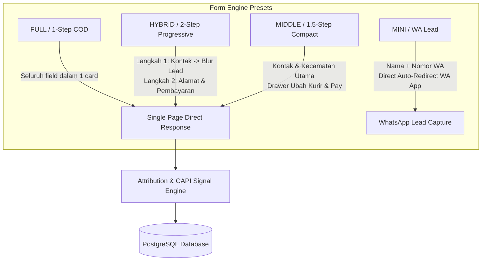

# DotAds Engine v2 — Form Engine & Preset Contracts Specification

> **Status:** Canonical Specification  
> **Target Audience:** Frontend Engineers, AI Coding Agents, UX Designers  
> **Supported Presets:** `FULL` (1-Step COD), `HYBRID` (2-Step Progressive Checkout), `MIDDLE` (Compact 1.5-Step Direct Checkout), `MINI` (2-Input WA Lead)  
> **Runtime Target:** `<dotads-form>` Shadow DOM Web Component, Astro SSR Storefront, Next.js Admin Builder Canvas  

---

## 1. Executive Summary & Preset Architecture Overview

Formulir pemesanan *Direct-Response Commerce* DotAds Engine v2 dirancang khusus untuk trafik iklan berkecepatan tinggi (Meta Ads, Google Ads, TikTok Ads). Sistem ini menyediakan 4 preset bentuk formulir dengan karakteristik logika bisnis, aliran data (*data flow*), dan tingkat kepresisian UI/UX yang terukur.



---

## 2. Dynamic Preset Specs: Logic, System, & UI/UX Precision

### 2.1 Preset FULL — 1-Step COD & Direct-Response Order Form

* **Target Penggunaan:** Halaman penjualan produk fisik *single-offer* dengan fokus pada kemudahan pembayaran COD (Bayar di Tempat).
* **Alur Logika & Sistem:**
  1. Seluruh input (Nama, WhatsApp, Alamat, Kecamatan, Kurir, Pembayaran) ditampilkan secara terbuka (*all-in-one*).
  2. Input nomor WhatsApp mendengarkan event `blur` untuk otomatis mengirimkan *Draft Lead* ke `/api/v1/public/leads/draft`.
  3. Menggunakan autocomplete pencarian kecamatan berbasis GIN Trigram SQL untuk resolusi ID Subdistrik (<15ms).
  4. Pengiriman form memicu penguncian tombol (*disabled state*) + eksekusi payload ke `/api/v1/public/orders`.
  5. Setelah respon HTTP 200 OK dari backend, Web Component menembakkan event Meta Pixel `Purchase` di sisi browser (`fbq('track', 'Purchase', ...)`), lalu me-redirect pembeli ke halaman `/thank-you?orderNumber=...`.

* **Spesifikasi UI/UX Presisi (FULL Mode):**
  * **Container:** Background putih (`#ffffff`), border `1px solid #e2e8f0`, border-radius `12px`, padding `24px`, shadow `0 4px 6px -1px rgba(0,0,0,0.05)`.
  * **Header Badge:** Badge keamanan SSL `256-Bit SSL Encrypted` dengan latar belakang `emerald-50`, teks `emerald-600`, icon `ShieldAlert`.
  * **Susunan Field (Urutan Atas-ke-Bawah):**
    1. `customerName`: Input teks biasa (*Placeholder: "Contoh: Budi Santoso"*). Label: `Nama Lengkap Pelanggan *`.
    2. `customerPhone`: Input tipe `tel` (*Placeholder: "081234567890"*). Label: `Nomor WhatsApp (Aktif) *`.
    3. `shippingAddress`: Textarea 3 baris (*Placeholder: "Jl. Merdeka No. 123, RT 01 RW 02"*). Label: `Alamat Lengkap Pengiriman *`.
    4. `subdistrictId`: Autocomplete Select Dropdown (*Placeholder: "Pilih Kecamatan..."*). Label: `Kecamatan & Kota *`.
    5. `courierCode`: Dropdown Pilihan Ekspedisi (`JNE`, `SICEPAT`, `J&T`, `SAP`). Label: `Pilihan Kurir Ekspedisi *`.
    6. `paymentMethod`: Dropdown Metode Pembayaran (`COD`, `QRIS`, `VA_BCA`, `VA_MANDIRI`). Label: `Metode Pembayaran *`.
  * **Submit Button:** Background biru `indigo-600` (`#2563eb`), teks putih `font-weight: 700`, padding `12px 20px`, border-radius `8px`, teks: **"Pesan Sekarang (COD / QRIS)"**. Hover state `#1d4ed8`, disabled state `#94a3b8` dengan animasi loading text *"Memproses Pesanan..."*.
  * **Error Container:** Box merah `fef2f2`, border `fecaca`, teks `991b1b`, font-size `0.875rem`, padding `12px`, border-radius `8px` (hanya muncul saat validasi/API error).

---

### 2.2 Preset HYBRID — 2-Step Progressive Checkout Form

* **Target Penggunaan:** Mengurangi beban kognitif pembeli (*cognitive overload*) pada landing page panjang, sekaligus mengamankan kontak prospek (*abandoned lead recovery*) sejak Langkah 1.
* **Alur Logika & Sistem:**
  * **Langkah 1 (Kontak Diri):** Pembeli mengisi `Nama Lengkap` dan `Nomor WhatsApp`.
    * Saat nomor WhatsApp valid (minimal 9 digit) dan pembeli berpindah field (`blur`) atau menekan **"Lanjut ke Alamat"**, sistem mengeksekusi *Draft Lead Ingestion* ke `/api/v1/public/leads/draft`.
    * Jika pembeli menutup halaman sebelum menyelesaikan Langkah 2, data kontak sudah tersimpan di database toko sebagai status `DRAFT` / `ABANDONED` untuk ditindaklanjuti oleh Customer Service via WhatsApp CRM.
  * **Langkah 2 (Alamat & Pembayaran):** Pembeli mengisi `Alamat Lengkap`, `Kecamatan`, `Ekspedisi`, dan `Metode Pembayaran`.
    * Tombol **"Kembali"** tersedia untuk merevisi data Langkah 1 tanpa menghapus isi input.
    * Pengiriman akhir membuat transaksi utuh bertipe `PENDING` (jika VA/QRIS) atau `PROCESSING` (jika COD).

* **Spesifikasi UI/UX Presisi (HYBRID Mode):**
  * **Progress Stepper Bar (Atas Form):**
    * Display 2 bulatan/tab stepper: `1. Data Diri` -> `2. Alamat & Pembayaran`.
    * State Aktif: Ring biru `indigo-600`, teks `font-bold text-slate-900`.
    * State Inaktif: Background `slate-100`, teks `text-slate-400`.
  * **Tampilan Langkah 1:**
    * Field `customerName` + `customerPhone`.
    * Tombol Lanjut: **"Lanjut ke Pengiriman & Pembayaran →"** (`bg-indigo-600 hover:bg-indigo-700`).
  * **Tampilan Langkah 2:**
    * Stepper otomatis berpindah ke angka 2.
    * Tampilan ringkasan kontak singkat (Nomor WA) di bagian atas Langkah 2 dengan link *"Ubah"*.
    * Field `shippingAddress`, `subdistrictId`, `courierCode`, `paymentMethod`.
    * Baris Tombol: Tombol **"← Kembali"** (`bg-slate-100 text-slate-700`) di sebelah kiri, dan tombol **"Konfirmasi Pesanan Sekarang"** (`bg-indigo-600 text-white flex-1`) di sebelah kanan.

---

### 2.3 Preset MIDDLE — Compact 1.5-Step Direct Checkout Form

* **Target Penggunaan:** Desain ringkas (*compact*) khusus layar smartphone (Mobile-First Webview) untuk memaksimalkan *speed conversion* dari Meta Ads.
* **Alur Logika & Sistem:**
  1. Menampilkan input utama (Nama, WA, Kecamatan) di layar utama.
  2. Ekspedisi & Metode Pembayaran telah diisi secara default ke opsi terbaik merchant (misal: `COD` + `JNE Regular`).
  3. Menyediakan tombol accordion / drawer **"Ubah Ekspedisi & Pembayaran (Optional)"** untuk pembeli yang ingin mengganti ke Virtual Account / QRIS atau kurir lain.
  4. Mengurangi *scroll depth* pada layar HP hingga 40% dibanding Preset FULL.

* **Spesifikasi UI/UX Presisi (MIDDLE Mode):**
  * **Field Utama:** `Nama Lengkap`, `Nomor WhatsApp`, `Kecamatan / Kota`.
  * **Default Selection Badge:** Box info kecil latar belakang `slate-50`, border `slate-200`:  
    *"Metode: COD (Bayar di Tempat) | Kurir: JNE Express (Ongkir Rp 10.000)"*.
  * **Toggle Button:** Teks link `text-xs font-bold text-indigo-600 flex items-center gap-1` dengan icon Chevron: **"Ubah Metode Pembayaran & Kurir"**.
  * **Accordion Box (Collapsible):** Saat diklik, membuka pilihan opsi `Payment Method` (QRIS, VA) dan pilihan `Courier Code` tanpa berpindah halaman.
  * **Submit Button:** Teks mencolok **"Beli Langsung (COD)"** warna kontras hijau `emerald-600` atau biru `indigo-600`.

---

### 2.4 Preset MINI — 2-Input Instant WhatsApp Lead Form

* **Target Penggunaan:** Jasa, produk kustom, penawaran harga khusus (*quote*), atau penjualan tiket/event berkonversi tinggi via konsultasi pesan WhatsApp.
* **Alur Logika & Sistem:**
  1. Formulir hanya terdiri dari 2 field: `Nama` dan `Nomor WhatsApp`.
  2. Saat tombol diklik, sistem mengeksekusi `POST /api/v1/public/leads/draft` untuk mencatat lead ke database.
  3. Seketika itu juga (tanpa jeda), browser langsung membuka tautan deep-link WhatsApp:  
     `https://wa.me/{merchantPhoneNumber}?text=Halo%20Admin,%20saya%20{customerName}%20tertarik%20dengan%20produk%20{productTitle}`.

* **Spesifikasi UI/UX Presisi (MINI Mode):**
  * **Form Layout:** Card bersih & ultra-minimalis (`max-width: 400px`).
  * **Fields:** Only `customerName` & `customerPhone`.
  * **Submit Button:** Warna khas WhatsApp `bg-emerald-600 hover:bg-emerald-700 text-white font-extrabold flex items-center justify-center gap-2`.
  * **Button Icon:** Icon WhatsApp / Message Square.
  * **Button Label:** **"Chat Admin via WhatsApp Sekarang"**.

---

## 3. Shadow DOM Web Component Specifications (`<dotads-form>`)

Sistem runtime form dieksekusi sebagai **Custom Element / Web Component** terisolasi dengan Shadow DOM (`attachShadow({ mode: "open" })`) agar gaya CSS dari tema luar (Astro / WordPress / Custom HTML) tidak merusak tampilan form.

### 3.1 Tag HTML & Supported Attributes
```html
<dotads-form
  tenant-id="2f2ca823-46bf-4ab5-a5fe-61a49d175fa8"
  api-host="https://api.dotads.id"
  form-schema-id="8c0402f0-e337-5b64-5ced-b1401955643d"
  mode="hybrid">
</dotads-form>
```

| Attribute | Tipe | Default | Deskripsi |
| :--- | :--- | :--- | :--- |
| `tenant-id` | `UUID` | Required | Identifikasi tenant/merchant pemilik toko |
| `api-host` | `URL` | `http://localhost:8787` | Endpoint URL REST API Headless |
| `form-schema-id` | `UUID` | Optional | ID skema formulir kustom dari Form Builder |
| `mode` | `Enum` | `"hybrid"` | Pilihan mode tampilan: `"full"`, `"hybrid"`, `"middle"`, `"mini"` |

---

## 4. Signal Engine & Ad Attribution Tracking Contract

Setiap penyerahan formulir (*submit*) secara otomatis mengidentifikasi dan menyertakan cookie atribusi iklan dari browser pembeli:

1. **Meta Ads Attribution:**
   * Cookie `_fbp`: Browser user tracker ID.
   * Cookie `_fbc`: Click ID dari iklan Meta (`fb.1.${timestamp}.${fbclid}`).
2. **Client-Side Event Firing:**
   * Setelah pembacaan respon sukses dari API order, Web Component mengeksekusi:
     ```javascript
     if (typeof window !== "undefined" && window.fbq) {
       window.fbq("track", "Purchase", {
         currency: "IDR",
         value: orderData.totalMinor / 100,
       });
     }
     ```
3. **Server-Side CAPI Outbox Fanout:**
   * Backend API `/api/v1/public/orders` secara bersamaan menyimpan transaksi ke `outbox_events` dengan `event_name: "Purchase"`, `event_id: order.id`, dan SHA-256 hashed customer phone/email untuk dikirimkan ke Meta Conversions API (CAPI) dengan skor EMQ 8.5–9.5+.

---

## 5. Zod Data Contract & OpenAPI Schema

```typescript
import { z } from "zod";

export const FormSchemaModeEnum = z.enum(["hybrid", "full", "middle", "mini"]);

export const PublicOrderCreateSchema = z.object({
  tenantId: z.string().uuid(),
  customerName: z.string().min(1, "Nama wajib diisi"),
  customerPhone: z.string().min(9, "Nomor WhatsApp tidak valid"),
  shippingAddress: z.string().optional(),
  subdistrictId: z.string().optional(),
  courierCode: z.string().optional(),
  paymentMethod: z.enum(["COD", "QRIS", "VA_BCA", "VA_MANDIRI"]).default("COD"),
  items: z.array(z.object({
    productId: z.string().uuid(),
    quantity: z.number().int().min(1).default(1),
  })),
  attribution: z.object({
    fbp: z.string().optional(),
    fbc: z.string().optional(),
  }).optional(),
});
```

---

## 6. Matrix Perbandingan Preset Formulir

| Parameter | FULL (1-Step COD) | HYBRID (2-Step) | MIDDLE (Compact 1.5-Step) | MINI (WA Lead) |
| :--- | :--- | :--- | :--- | :--- |
| **Jumlah Langkah** | 1 Langkah | 2 Langkah Stepper | 1 Langkah + Accordion | 1 Langkah |
| **Draft Lead Blur Capture** | Ya (pada WA field) | Ya (pada WA & Step 1) | Ya (pada WA field) | Instant pada Submit |
| **Pencarian Kecamatan** | Langsung di form | Pada Langkah 2 | Langsung di form | Tidak ada (N/A) |
| **Target Trafik Utama** | Single-Product COD | Direct LP / Meta Ads | Mobile Webview Ads | High-Ticket / Service |
| **Kecepatan Konversi** | ⭐⭐⭐⭐ | ⭐⭐⭐⭐⭐ | ⭐⭐⭐⭐⭐ | ⭐⭐⭐⭐⭐ |
| **Kelengkapan Data** | 100% Lengkap | 100% Lengkap | 100% Lengkap | Data Kontak Saja |
