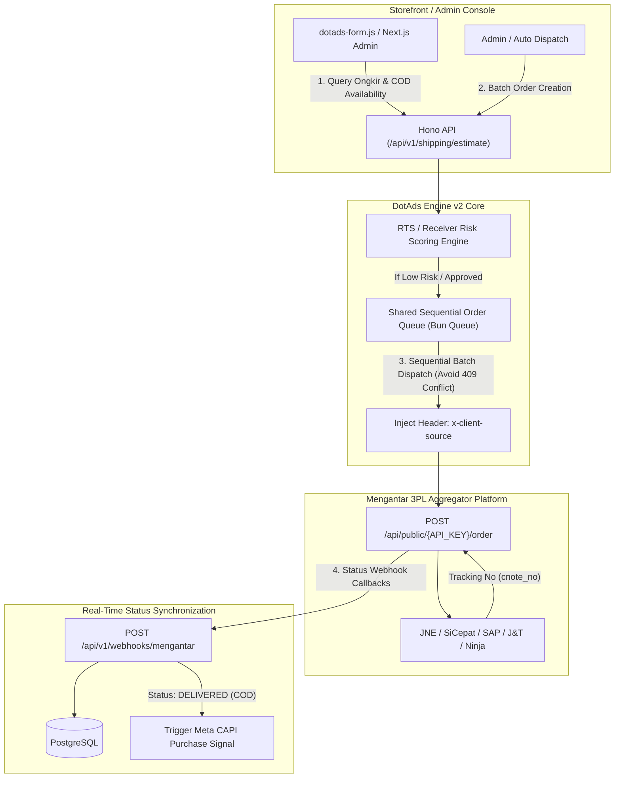
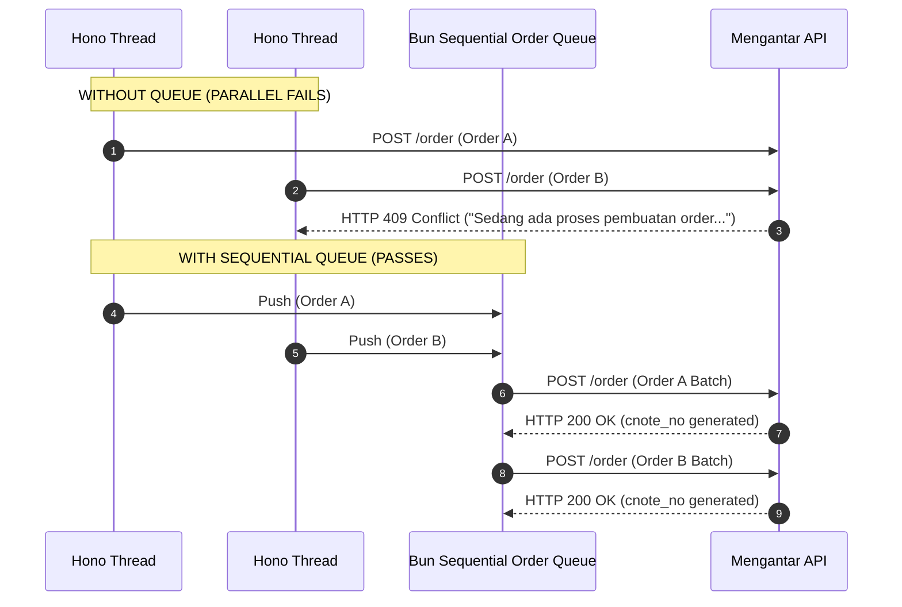
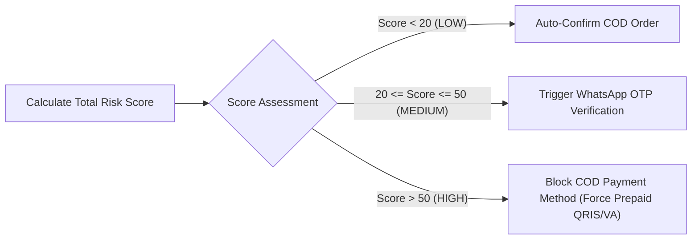
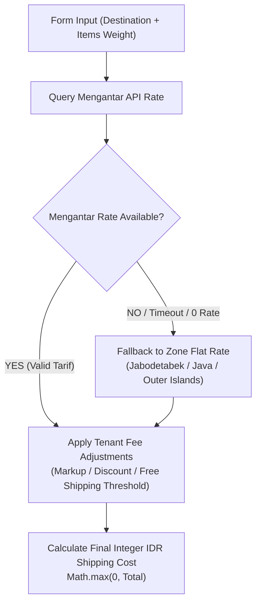

# DotAds Engine v2 — Mengantar API Integration & Logistics Specification

**Document Version:** 2.0.0  
**Status:** APPROVED FOR IMPLEMENTATION  
**System Target:** DotAds Engine v2 (Hono API Backend + Bun Worker + Drizzle ORM + PostgreSQL)  
**Target Aggregator:** Mengantar API (Indonesian 3PL Logistics: JNE, SiCepat, SAP Express, J&T Express, Ninja Xpress, IDExpress, Lion Parcel, Anteraja)  

---

## 1. Executive Summary & Integration Topology

The **Mengantar Logistics Engine** in DotAds Engine v2 provides automated 3PL shipping calculation, Cash On Delivery (COD) balance management, waybill (`cnote_no`) generation, label printing, and real-time webhook status synchronization.



---

## 2. API Topology & Authentication Protocol

### 2.1 Base URL & Header Standard

- **Production Endpoint:** `https://api.mengantar.id/api/public/{API_KEY}`
- **Sandbox Endpoint:** `https://sandbox.mengantar.id/api/public/{API_KEY_SANDBOX}`
- **Required HTTP Headers:**
  - `Content-Type: application/json`
  - `x-client-source: cmsads-engine-v2` *(Mandatory: Prevents default `directCall` attribution in Mengantar backend)*

---

## 3. Estimation Tiers & Mandatory Route Validation

### 3.1 Estimation Endpoints Matrix

Mengantar provides three distinct estimation endpoints based on the integration tier.

| Tier Name | Endpoint Route | Description & Pricing Rules |
| :--- | :--- | :--- |
| **Retail Public** | `POST /order/estimate` | Single courier estimation with retail promotional discounts (~20%). |
| **Retail All Public** | `POST /order/allEstimatePublic` | Multi-courier estimation list with retail promotional discounts. |
| **3PL / B2B Enterprise** | `POST /order/allEstimate3PL` | System-to-system raw courier tariff estimation (no promotional markups). Recommended for DotAds v2 multi-tenant core. |

---

### 3.2 Route Validation Invariant (Mandatory Pre-Checkout Check)

Before displaying shipping options or accepting a checkout form in `dotads-form.js`, DotAds Engine v2 MUST validate two mandatory boolean flags in the estimation payload:

```typescript
// src/services/shipping/route-validator.ts

export interface MengantarEstimateResponse {
  code: string; // Courier code (e.g. 'jne_reg', 'sicepat_gokil')
  courier_name: string;
  service_name: string;
  price: number;
  unsupported: boolean;      // Route unreachable
  unsupported_cod: boolean;  // COD disabled for this destination
}

export interface ValidatedShippingOption {
  code: string;
  name: string;
  price: number;
  isAvailable: boolean;
  isCodAvailable: boolean;
}

export function filterShippingOptions(
  estimates: MengantarEstimateResponse[],
  paymentMethod: 'COD' | 'PREPAID'
): ValidatedShippingOption[] {
  return estimates
    .filter((est) => !est.unsupported) // Filter out unreachable routes
    .map((est) => ({
      code: est.code,
      name: `${est.courier_name} (${est.service_name})`,
      price: est.price,
      isAvailable: !est.unsupported,
      isCodAvailable: !est.unsupported_cod,
    }))
    .filter((option) => paymentMethod !== 'COD' || option.isCodAvailable);
}
```

---

## 4. Rate Limiting, Concurrency & Sequential Order Queue

### 4.1 The Concurrency Block Trap (`409 Conflict`)

Couriers like J&T Express, Ninja Xpress, and SiCepat generate waybills dynamically via active API sessions. Firing parallel concurrent `POST /order` calls will trigger HTTP `409 Conflict` ("*Sedang ada proses pembuatan order...*") and cause immediate rate-limit bans from Mengantar.



---

### 4.2 Shared Sequential Queue Implementation (Bun Queue Worker)

```typescript
// src/services/shipping/order-queue.ts
import { db } from '@/db';
import { orders } from '@/db/schema/orders';
import { eq } from 'drizzle-orm';

interface QueuedOrderPayload {
  tenantId: string;
  orderId: string;
  mengantarApiKey: string;
  orderData: Record<string, any>;
}

class SequentialOrderQueue {
  private queue: QueuedOrderPayload[] = [];
  private isProcessing = false;

  public push(orderPayload: QueuedOrderPayload) {
    this.queue.push(orderPayload);
    this.process();
  }

  private async process() {
    if (this.isProcessing || this.queue.length === 0) return;
    this.isProcessing = true;

    while (this.queue.length > 0) {
      const item = this.queue.shift();
      if (!item) break;

      try {
        const endpoint = `https://api.mengantar.id/api/public/${item.mengantarApiKey}/order`;
        const response = await fetch(endpoint, {
          method: 'POST',
          headers: {
            'Content-Type': 'application/json',
            'x-client-source': 'cmsads-engine-v2',
          },
          body: JSON.stringify([item.orderData]), // Batch payload array format
        });

        const resData = await response.json();

        if (response.ok && resData.status === 'success') {
          const resultOrder = resData.data?.[0];
          
          if (resultOrder?.cnote_no) {
            await db.update(orders)
              .set({
                cnoteNo: resultOrder.cnote_no,
                shippingStatus: 'MANIFEST',
                updatedAt: new Date(),
              })
              .where(eq(orders.id, item.orderId));
          } else if (resultOrder?.isPaid === false) {
            // Non-COD Insufficient Wallet Balance Trap
            await db.update(orders)
              .set({
                shippingStatus: 'PENDING_TOPUP',
                mengantarOrderId: resultOrder.id,
                updatedAt: new Date(),
              })
              .where(eq(orders.id, item.orderId));
          }
        }
      } catch (err) {
        console.error('[MENGANTAR-QUEUE-ERROR]', err);
      }

      // Enforce 300ms inter-request cooldown to respect courier API limits
      await new Promise((resolve) => setTimeout(resolve, 300));
    }

    this.isProcessing = false;
  }
}

export const mengantarOrderQueue = new SequentialOrderQueue();
```

---

### 4.3 Non-COD Wallet Balance Protocol

For non-COD shipments, courier fees are deducted directly from the tenant's Mengantar Wallet balance.

- **Insufficient Balance Behavior:** If wallet balance is insufficient, `POST /order` returns HTTP 200 with `isPaid: false` and `cnote_no: null`.
- **System Handling Rule:** Set internal order shipping status to `PENDING_TOPUP`. After tenant tops up their wallet, trigger `POST /order/pay-unpaid` with the `mengantar_order_id` to retrieve the active `cnote_no`.

---

### 4.4 Scheduled Pickup Time Restriction

When specifying pickup schedules via `POST /time`, the scheduled datetime (`date` + `time`) MUST be at least **90 minutes in the future** (`Date.now() + 90 * 60 * 1000`). If closer, the Mengantar API will reject the request.

---

## 5. Location Resolution & Sub-district Mapping

Indonesian shipping requires precision location mapping (Kecamatan / Sub-district and Kab-Kota / City).

### 5.1 Location Cache Schema (PostgreSQL)

```typescript
// src/db/schema/mengantar-locations.ts
import { pgTable, uuid, varchar, text, timestamp, index } from 'drizzle-orm/pg-core';

export const mengantarLocations = pgTable('mengantar_locations', {
  id: uuid('id').primaryKey().defaultRandom(),
  mengantarId: varchar('mengantar_id', { length: 64 }).notNull().unique(),
  subdistrictName: varchar('subdistrict_name', { length: 128 }).notNull(), // Kecamatan
  cityName: varchar('city_name', { length: 128 }).notNull(),             // Kab-Kota
  provinceName: varchar('province_name', { length: 128 }).notNull(),         // Provinsi
  postalCode: varchar('postal_code', { length: 10 }).notNull(),
  rawSearchQuery: text('raw_search_query').notNull(),
  createdAt: timestamp('created_at', { withTimezone: true }).defaultNow(),
}, (table) => ({
  searchIdx: index('idx_mengantar_location_search').on(table.subdistrictName, table.cityName),
}));
```

---

## 6. RTS (Return To Sender) / Receiver Risk Scoring Algorithm

To protect tenants from high COD losses (where return shipping costs hit the merchant), DotAds Engine v2 executes an automated **Receiver Risk Scoring Algorithm** before confirming COD orders.

### 6.1 Multi-Factor Risk Scoring Matrix

$$	ext{Risk Score} = S_{	ext{cancel}} + S_{	ext{rts}} + S_{	ext{address}} + S_{	ext{phone}}$$

| Risk Factor | Criteria & Metrics | Score Weight |
| :--- | :--- | :--- |
| **Previous RTS History** | > 2 previous RTS deliveries on customer phone | **+45 Points** |
| **Previous Cancellations** | > 2 unconfirmed order cancellations | **+25 Points** |
| **Address Incompleteness** | Missing house number, RT/RW, or landmark | **+20 Points** |
| **Phone Line Validity** | Non-WhatsApp registered / Landline / Fake number | **+30 Points** |
| **Postal Code Mismatch** | Sub-district does not match postal code database | **+15 Points** |

---

### 6.2 Risk Tier Action Matrix



```typescript
// src/services/risk/receiver-risk-engine.ts
import { db } from '@/db';
import { orders } from '@/db/schema/orders';
import { eq, and } from 'drizzle-orm';
import { normalizePhone } from '@/lib/tracking/normalization';

export interface CustomerRiskAssessment {
  phone: string;
  address: string;
  subdistrictId: string;
  postalCode: string;
}

export interface RiskScoreResult {
  score: number;
  tier: 'LOW' | 'MEDIUM' | 'HIGH';
  reasons: string[];
  allowCod: boolean;
  requiresOtp: boolean;
}

export async function evaluateReceiverRisk(
  tenantId: string,
  input: CustomerRiskAssessment
): Promise<RiskScoreResult> {
  const normalizedPhone = normalizePhone(input.phone);
  let score = 0;
  const reasons: string[] = [];

  // 1. Query past tenant history by phone hash
  const pastOrders = await db
    .select({
      shippingStatus: orders.shippingStatus,
      status: orders.status,
    })
    .from(orders)
    .where(
      and(
        eq(orders.tenantId, tenantId),
        eq(orders.customerPhoneHash, normalizedPhone)
      )
    );

  const rtsCount = pastOrders.filter((o) => o.shippingStatus === 'RTS').length;
  const cancelCount = pastOrders.filter((o) => o.status === 'CANCELLED').length;

  if (rtsCount > 0) {
    score += Math.min(rtsCount * 45, 90);
    reasons.push(`History of ${rtsCount} Return To Sender (RTS) shipments.`);
  }

  if (cancelCount > 1) {
    score += 25;
    reasons.push(`History of ${cancelCount} cancelled orders.`);
  }

  // 2. Address Completeness Heuristic
  const addr = input.address.toLowerCase();
  const hasNumber = /[0-9]/.test(addr);
  const hasKeyword = /(jalan|jl|rt|rw|gang|gg|blok|no|no\.)/.test(addr);

  if (!hasNumber || !hasKeyword || addr.length < 15) {
    score += 20;
    reasons.push('Incomplete street address details (missing RT/RW/House No).');
  }

  // 3. Assign Tier
  let tier: 'LOW' | 'MEDIUM' | 'HIGH' = 'LOW';
  let allowCod = true;
  let requiresOtp = false;

  if (score > 50) {
    tier = 'HIGH';
    allowCod = false; // Force Prepaid
  } else if (score >= 20) {
    tier = 'MEDIUM';
    requiresOtp = true; // Require WA OTP
  }

  return {
    score,
    tier,
    reasons,
    allowCod,
    requiresOtp,
  };
}
```

---

## 7. Thermal Shipping Label Generation (`POST /order/print`)

DotAds Engine v2 integrates thermal label printing directly into the Next.js Admin Order Management surface.

- **API Endpoint:** `POST /api/public/{API_KEY}/order/print`
- **Request Body:** `{ "order_id": ["MENGANTAR_ORDER_ID_1", "MENGANTAR_ORDER_ID_2"] }`
- **Output Format:** Thermal 4x6 inch (100x150 mm) PDF stream containing barcode, waybill (`cnote_no`), sender address, receiver address, and COD collectable amount.

---

## 8. Webhook Status Sync Lifecycle & Event Handling

Mengantar sends real-time shipping progress updates via HTTP POST webhooks to DotAds Engine v2.

### 8.1 Webhook Endpoint & Event Mapping Matrix

- **Endpoint Route:** `POST /api/v1/webhooks/mengantar`

| Mengantar Status String | Internal Shipping Status | Database State Action | Secondary System Action |
| :--- | :--- | :--- | :--- |
| `MANIFEST` / `PICKUP` | `MANIFEST` | Update order shipment status | Notify customer via WA |
| `IN_TRANSIT` | `IN_TRANSIT` | Update order shipment status | None |
| `OUT_FOR_DELIVERY` | `OUT_FOR_DELIVERY` | Update order shipment status | Send WA delivery notice |
| `DELIVERED` | `DELIVERED` | Set payment status = `PAID` (if COD) | **Trigger Meta CAPI `Purchase` Event** |
| `RTS` / `RETURNED` | `RTS` | Set shipping status = `RTS` | Increment Customer Risk Penalty |
| `CANCELLED` | `CANCELLED` | Set order status = `CANCELLED` | Restock Inventory |

---

### 8.2 Hono Webhook Handler Implementation

```typescript
// src/routes/webhooks/mengantar.ts
import { Hono } from 'hono';
import { db } from '@/db';
import { orders } from '@/db/schema/orders';
import { shippingShipmentLogs } from '@/db/schema/shipping-logs';
import { capiEventOutbox } from '@/db/schema/capi-outbox';
import { eq } from 'drizzle-orm';
import { generateEventId } from '@/lib/tracking/event-id';

export const mengantarWebhookRouter = new Hono();

mengantarWebhookRouter.post('/api/v1/webhooks/mengantar', async (c) => {
  const body = await c.req.json();
  const { cnote_no, status, history, updated_at } = body;

  if (!cnote_no || !status) {
    return c.json({ error: 'Invalid Webhook Payload' }, 400);
  }

  // 1. Fetch Order by Waybill
  const [existingOrder] = await db
    .select()
    .from(orders)
    .where(eq(orders.cnoteNo, cnote_no))
    .limit(1);

  if (!existingOrder) {
    return c.json({ message: 'Order Not Found (Ignored)' }, 200);
  }

  // 2. Audit Log Shipping Milestone
  await db.insert(shippingShipmentLogs).values({
    tenantId: existingOrder.tenantId,
    orderId: existingOrder.id,
    cnoteNo: cnote_no,
    courierStatus: status,
    historyJson: history || [],
    rawPayload: body,
  });

  // 3. Status Transition Logic
  let newShippingStatus = existingOrder.shippingStatus;
  let newPaymentStatus = existingOrder.paymentStatus;

  switch (status.toUpperCase()) {
    case 'MANIFEST':
    case 'PICKUP':
      newShippingStatus = 'MANIFEST';
      break;
    case 'IN_TRANSIT':
      newShippingStatus = 'IN_TRANSIT';
      break;
    case 'OUT_FOR_DELIVERY':
      newShippingStatus = 'OUT_FOR_DELIVERY';
      break;
    case 'DELIVERED':
      newShippingStatus = 'DELIVERED';
      if (existingOrder.paymentMethod === 'COD') {
        newPaymentStatus = 'PAID';
      }
      break;
    case 'RTS':
    case 'RETURNED':
      newShippingStatus = 'RTS';
      break;
    case 'CANCELLED':
      newShippingStatus = 'CANCELLED';
      break;
  }

  // 4. Update Order Record
  await db.update(orders)
    .set({
      shippingStatus: newShippingStatus,
      paymentStatus: newPaymentStatus,
      updatedAt: new Date(),
    })
    .where(eq(orders.id, existingOrder.id));

  // 5. Fire Meta CAPI Purchase on COD Delivery Success
  if (status.toUpperCase() === 'DELIVERED' && existingOrder.paymentMethod === 'COD') {
    const purchaseEventId = generateEventId.purchase(existingOrder.id);

    await db.insert(capiEventOutbox).values({
      tenantId: existingOrder.tenantId,
      eventId: purchaseEventId,
      eventName: 'Purchase',
      pixelId: existingOrder.pixelId || '',
      payload: {
        event_name: 'Purchase',
        event_time: Math.floor(Date.now() / 1000),
        event_id: purchaseEventId,
        action_source: 'website',
        user_data: {
          ph: [existingOrder.customerPhoneHash],
          fn: [existingOrder.customerFirstNameHash],
        },
        custom_data: {
          currency: 'IDR',
          value: Number(existingOrder.totalAmount),
          order_id: existingOrder.id,
        },
      },
      status: 'pending',
    }).onConflictDoNothing();
  }

  return c.json({ success: true, message: 'Webhook Processed' });
});
```

---

## 9. Sandbox Environment Setup & Testing Traps

When executing automated or manual testing using sandbox API keys (`api-key-sandbox`), engineers MUST observe these hardcoded limitations to avoid false-negative bugs:

1. **JNE Sandbox Trap:** The origin `PICKUP_ADDRESS` MUST be registered in **Jakarta**. Non-Jakarta origin addresses will throw route error exceptions.
2. **SAP Express Sandbox Trap:** SAP Sandbox supports **Non-COD ONLY**, and the route MUST be strictly **Jakarta to Jakarta**.
3. **Sandbox Balance Trap:** Sandbox wallet balance requires top-up simulation via Midtrans Sandbox payment simulator before non-COD testing.


---

## 7. Fast Kecamatan Database Cache & Custom Shipping Fee Adjustment Protocol

### 7.1 Pre-Seeded PostgreSQL Kecamatan Database (`mengantar_locations`)

To guarantee instant (<15ms) autocomplete responses in `dotads-form.js` without hammering the Mengantar API on every user keystroke, DotAds Engine v2 pre-seeds and maintains a full local PostgreSQL cache of all ~7,200+ Indonesian Kecamatan (Sub-districts).

```typescript
// src/db/schema/mengantar-locations.ts
import { pgTable, uuid, varchar, text, timestamp, index } from 'drizzle-orm/pg-core';
import { sql } from 'drizzle-orm';

export const mengantarLocations = pgTable('mengantar_locations', {
  id: uuid('id').primaryKey().defaultRandom(),
  mengantarId: varchar('mengantar_id', { length: 64 }).notNull().unique(), // Mengantar subdistrict ID
  subdistrictName: varchar('subdistrict_name', { length: 128 }).notNull(), // Kecamatan (e.g. "Kebayoran Baru")
  cityName: varchar('city_name', { length: 128 }).notNull(),               // Kab-Kota (e.g. "Jakarta Selatan")
  provinceName: varchar('province_name', { length: 128 }).notNull(),           // Provinsi (e.g. "DKI Jakarta")
  postalCode: varchar('postal_code', { length: 10 }).notNull(),
  zoneGroup: varchar('zone_group', { length: 32 }).notNull().default('JAVA'), // JABODETABEK, JAVA, BALI_NUSA, SUMATRA, SULAWESI, KALIMANTAN, PAPUA
  rawSearchQuery: text('raw_search_query').notNull(),
  createdAt: timestamp('created_at', { withTimezone: true }).defaultNow(),
}, (table) => ({
  // Trigram index for fast ILIKE & fuzzy text search
  trgmIdx: index('idx_mengantar_location_trgm').using('gin', sql`${table.rawSearchQuery} gin_trgm_ops`),
}));
```

#### Fast Typeahead API Query (`GET /api/v1/public/regions/search?q=kebayoran`)
```sql
SELECT mengantar_id, subdistrict_name, city_name, province_name, postal_code
FROM mengantar_locations
WHERE raw_search_query ILIKE '%kebayoran%'
ORDER BY subdistrict_name ASC
LIMIT 15;
```

---

### 7.2 Mengantar Shipping Validation & Fallback / Custom Fee Adjustment Protocol

When a customer selects a shipping option, DotAds Engine v2 executes the **Shipping Resolution Pipeline**:



#### 7.2.1 Custom Fee Adjustment & Fallback Rules
Tenants can configure custom shipping rules in `Pengaturan > Store & CS`:

1. **Fallback Zone Rates (When Mengantar API is uncalculated, missing, or timed out):**
   - `JABODETABEK`: Rp 9,000 / kg
   - `JAVA`: Rp 15,000 / kg
   - `SUMATRA_BALI`: Rp 25,000 / kg
   - `KALIMANTAN_SULAWESI`: Rp 32,000 / kg
   - `PAPUA_EAST`: Rp 45,000 / kg

2. **Custom Surcharges & Subsidies (Potongan & Surcharge Ongkir):**
   - **Free Shipping Threshold (`free_shipping_min_subtotal_idr`):** If Order Subtotal $\ge$ Configured Threshold (e.g. Rp 250,000), Shipping Fee = Rp 0.
   - **Flat Subsidy (`shipping_subsidy_idr`):** Deduct flat amount from shipping fee (e.g. Potongan Ongkir Rp 5,000).
   - **Handling / Packing Fee (`handling_fee_idr`):** Add flat packing fee (e.g. Rp 2,000).

#### 7.2.2 Calculation Invariant (TypeScript Engine)
```typescript
// src/services/shipping/calculator.ts

export interface ShippingAdjustmentRule {
  freeShippingMinSubtotalIdr?: number | null;
  shippingSubsidyIdr?: number;
  handlingFeeIdr?: number;
  fallbackZoneRatesIdr: Record<string, number>;
}

export function calculateFinalShippingFee(
  baseRateIdr: number | null,
  zoneGroup: string,
  totalWeightKg: number,
  orderSubtotalIdr: number,
  rules: ShippingAdjustmentRule
): number {
  // 1. Free Shipping Threshold Gate
  if (rules.freeShippingMinSubtotalIdr && orderSubtotalIdr >= rules.freeShippingMinSubtotalIdr) {
    return 0;
  }

  // 2. Resolve Base Rate or Fallback Zone Rate
  let cost = baseRateIdr;
  if (cost === null || cost <= 0) {
    const zoneRatePerKg = rules.fallbackZoneRatesIdr[zoneGroup] ?? 20000;
    cost = Math.ceil(totalWeightKg) * zoneRatePerKg;
  }

  // 3. Apply Custom Subsidy & Handling Fee
  const subsidy = rules.shippingSubsidyIdr ?? 0;
  const handling = rules.handlingFeeIdr ?? 0;

  const finalCost = cost - subsidy + handling;

  // Invariant: Shipping fee can never be negative
  return Math.max(0, Math.round(finalCost));
}
```
