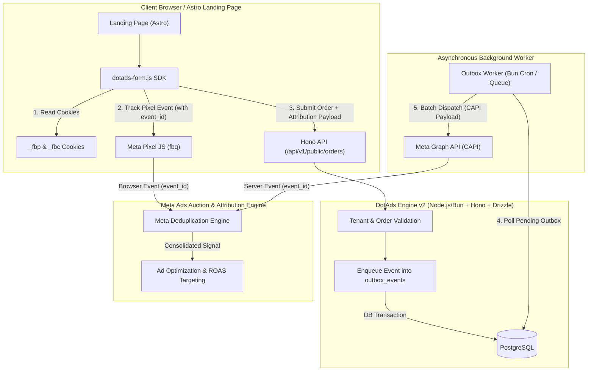
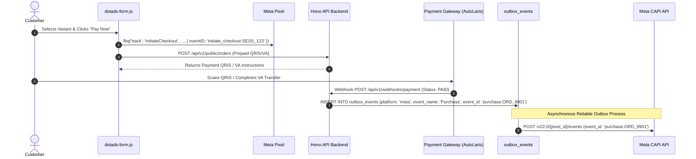
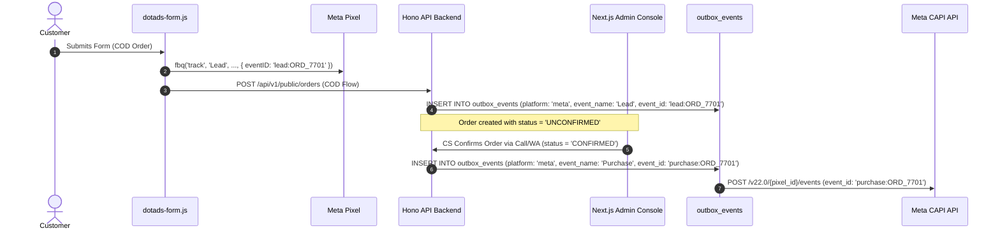

# DotAds Engine v2 — Meta Ads Signal Engine & Tracking Specification

**Document Version:** 2.0.0  
**Status:** APPROVED FOR IMPLEMENTATION  
**System Target:** DotAds Engine v2 (Hono API + Astro Storefront + Next.js Admin + `dotads-form.js` SDK)  
**Target Multi-Tenancy:** PostgreSQL Row-Level Multi-Tenancy (`tenant_id`)  

---

## 1. Executive Summary & Architecture Overview

The **Meta Ads Signal Engine** in DotAds Engine v2 provides an enterprise-grade, zero-loss signal tracking and attribution system. By combining high-speed browser-side Pixel tracking (`fbq`) with a server-authoritative Conversions API (CAPI) transactional outbox, DotAds Engine v2 guarantees optimal **Event Match Quality (EMQ 8.5–9.5+)**, deterministic **48-hour event deduplication**, and resilient **Cash On Delivery (COD) vs. Prepaid conversion attribution**.



---

## 2. Signal Taxonomy & Event Lifecycle

DotAds Engine v2 maps user journey milestones to 6 standard Meta event types. Each event carries specific payload requirements and server-authoritative firing rules.

### 2.1 Event Taxonomy Matrix

| Event Name | Trigger Point | Firing Channel | Key Custom Data | Deterministic `event_id` Format |
| :--- | :--- | :--- | :--- | :--- |
| `PageView` | Astro Landing Page initial render | Browser (`fbq`) + Server Island | `page_title`, `url` | `page_view:<session_id>` |
| `ViewContent` | Form expanded or product variant highlighted | Browser (`fbq`) | `content_ids`, `content_type`, `value`, `currency` | `view_content:<lp_id>:<session_id>` |
| `AddToCart` | Variant / package selected in `dotads-form.js` | Browser (`fbq`) | `content_ids`, `contents`, `value`, `currency` | `add_to_cart:<session_id>:<variant_id>` |
| `InitiateCheckout` | Focus on first form input field | Browser (`fbq`) | `content_ids`, `value`, `currency`, `num_items` | `initiate_checkout:<session_id>` |
| `Lead` | COD Order form submitted (Status: `UNCONFIRMED`) | Browser (`fbq`) + Server CAPI | `content_ids`, `value`, `currency`, `order_id` | `lead:<order_id>` |
| `Purchase` | **Prepaid:** Webhook payment success (`PAID`)<br>**COD:** Backend Order Confirmed or Delivered | Server CAPI (Server-Authoritative) | `content_ids`, `contents`, `value`, `currency`, `order_id` | `purchase:<order_id>` |

---

### 2.2 Prepaid vs. Cash On Delivery (COD) Signal Flow

#### Prepaid Flow (Instant Verification)


#### Cash On Delivery (COD) Flow (High-Attribution Integrity)


> **Inviolable COD Signal Rule:** Form submission in a COD funnel MUST fire `Lead` (or custom event `OrderPlaced`), NOT `Purchase`. Firing `Purchase` on unconfirmed COD form submissions trains Meta's ad auction to optimize for fake numbers, junk addresses, and high Return-To-Sender (RTS) buyers.

---

## 3. Server-Authoritative Deduplication Protocol

Meta deduplicates paired browser and server events using the combination of `event_name` and `event_id` received within a **48-hour window**.

### 3.1 `event_id` Generation Standards

`event_id` strings MUST be generated deterministically and identically across browser and server runtimes.

```typescript
// src/lib/tracking/event-id.ts

export interface EventIdGenerator {
  pageView: (sessionId: string) => string;
  viewContent: (lpId: string, sessionId: string) => string;
  addToCart: (sessionId: string, variantId: string) => string;
  initiateCheckout: (sessionId: string) => string;
  lead: (orderId: string) => string;
  purchase: (orderId: string) => string;
}

export const generateEventId: EventIdGenerator = {
  pageView: (sessionId: string) => `page_view:${sessionId.trim()}`,
  viewContent: (lpId: string, sessionId: string) => `view_content:${lpId.trim()}:${sessionId.trim()}`,
  addToCart: (sessionId: string, variantId: string) => `add_to_cart:${sessionId.trim()}:${variantId.trim()}`,
  initiateCheckout: (sessionId: string) => `initiate_checkout:${sessionId.trim()}`,
  lead: (orderId: string) => `lead:${orderId.trim()}`,
  purchase: (orderId: string) => `purchase:${orderId.trim()}`,
};
```

### 3.2 Browser & Server Code Examples

#### Browser Pixel Firing (`dotads-form.js`)
```javascript
// Inside dotads-form.js Web Component
const orderId = 'ORD-2026-8812';
const eventId = `lead:${orderId}`;

// 1. Browser Pixel Dispatch
if (typeof window.fbq === 'function') {
  window.fbq('track', 'Lead', {
    value: 299000,
    currency: 'IDR',
    content_ids: ['VAR-SKU-60'],
    content_type: 'product',
  }, {
    eventID: eventId
  });
}

// 2. Transmit exact eventId to Hono API backend for CAPI pairing
await fetch('/api/v1/public/orders', {
  method: 'POST',
  headers: { 'Content-Type': 'application/json' },
  body: JSON.stringify({
    orderId,
    eventId,
    // ... customer & payment fields
  })
});
```

---

## 4. First-Party Cookie & Attribution Preservation (`_fbp` / `_fbc`)

Attribution preservation depends on capturing Meta's first-party browser cookies (`_fbp` and `_fbc`) and routing them untouched to Meta CAPI.

### 4.1 Cookie Specifications

- `_fbp`: Format `fb.1.${timestamp}.${randomNumber}`. Generated automatically by Meta Pixel in document cookies.
- `_fbc`: Format `fb.1.${timestamp}.${fbclid}`. Present when traffic arrives with a `?fbclid=...` URL parameter.

### 4.2 Extraction & SDK Propagation Implementation

`dotads-form.js` captures `_fbp` and `_fbc` upon script initialization and stores them in `sessionStorage` to ensure survival across multi-page LP funnels.

```typescript
// src/sdk/dotads-form-attribution.ts

export interface AttributionContext {
  fbp: string | null;
  fbc: string | null;
  fbclid: string | null;
  userIp?: string;
  userAgent?: string;
}

export function extractAttributionContext(): AttributionContext {
  const getCookie = (name: string): string | null => {
    const value = `; ${document.cookie}`;
    const parts = value.split(`; ${name}=`);
    if (parts.length === 2) return parts.pop()?.split(';').shift() || null;
    return null;
  };

  const urlParams = new URLSearchParams(window.location.search);
  const fbclid = urlParams.get('fbclid');

  let fbc = getCookie('_fbc');
  if (!fbc && fbclid) {
    const timestamp = Math.floor(Date.now() / 1000);
    fbc = `fb.1.${timestamp}.${fbclid}`;
    // Set 90-day cookie
    document.cookie = `_fbc=${fbc}; path=/; max-age=${90 * 24 * 60 * 60}; SameSite=Lax`;
  }

  const fbp = getCookie('_fbp');

  return {
    fbp,
    fbc,
    fbclid,
    userAgent: navigator.userAgent,
  };
}
```

> **Critical Handling Rule:** `_fbp` and `_fbc` MUST NEVER be SHA-256 hashed. They MUST be sent to Meta CAPI in their raw string format (`user_data.fbp` and `user_data.fbc`).

---

## 5. Advanced Matching & Customer Identity Normalization

To reach an **Event Match Quality (EMQ) score of 8.5–9.5+**, DotAds Engine v2 normalizes customer PII before performing SHA-256 hashing.

### 5.1 Field Hashing Matrix

| Parameter Key | Description | Normalization Rule | SHA-256 Hashed? |
| :--- | :--- | :--- | :--- |
| `em` | Customer Email | Trim leading/trailing whitespace, lowercase | **YES** |
| `ph` | Customer Phone | Strip non-digits, format E.164 (leading 0 → 62) | **YES** |
| `fn` | First Name | Lowercase, strip punctuation & spaces | **YES** |
| `ln` | Last Name | Lowercase, strip punctuation & spaces | **YES** |
| `ct` | City / Kab-Kota | Lowercase, strip spaces & punctuation | **YES** |
| `st` | State / Province | Lowercase, strip spaces & punctuation | **YES** |
| `zp` | Postal Code | Strip non-alphanumeric characters | **YES** |
| `country` | Country Code | Lowercase ISO 2-letter (e.g. `id`) | **YES** |
| `external_id` | Unique Customer/User ID | First-party customer UUID | **YES** |
| `fbp` | Meta Browser Cookie | None (Raw string) | **NO (RAW)** |
| `fbc` | Meta Click Cookie | None (Raw string) | **NO (RAW)** |
| `client_ip_address` | User IP Address | IPv4 / IPv6 format | **NO (RAW)** |
| `client_user_agent` | User Agent | Browser User-Agent Header | **NO (RAW)** |

---

### 5.2 TypeScript Identity Normalization Utility

```typescript
// src/lib/tracking/normalization.ts
import { createHash } from 'node:crypto';

export function sha256(value: string): string {
  return createHash('sha256').update(value).digest('hex');
}

/**
 * Normalizes Indonesian & International phone numbers to E.164 without '+'
 * Example: "0812-3456-7890" -> "6281234567890" -> sha256
 */
export function normalizePhone(phone: string, defaultCountryPrefix = '62'): string {
  let cleaned = phone.replace(/[^0-9]/g, '');
  if (cleaned.startsWith('0')) {
    cleaned = defaultCountryPrefix + cleaned.substring(1);
  }
  return sha256(cleaned);
}

/**
 * Normalizes email according to Meta standard:
 * Lowercase, whitespace trimmed -> sha256
 */
export function normalizeEmail(email: string): string {
  const cleaned = email.trim().toLowerCase();
  return sha256(cleaned);
}

/**
 * Normalizes general text fields (first_name, city, province)
 */
export function normalizeText(text: string): string {
  const cleaned = text.trim().toLowerCase().replace(/[^a-z0-9]/g, '');
  return sha256(cleaned);
}

export interface UserDataPayload {
  em?: string[];
  ph?: string[];
  fn?: string[];
  ln?: string[];
  ct?: string[];
  st?: string[];
  zp?: string[];
  country?: string[];
  external_id?: string[];
  fbp?: string;
  fbc?: string;
  client_ip_address?: string;
  client_user_agent?: string;
}

export function buildNormalizedUserData(raw: {
  email?: string;
  phone?: string;
  firstName?: string;
  lastName?: string;
  city?: string;
  province?: string;
  postalCode?: string;
  customerId?: string;
  fbp?: string;
  fbc?: string;
  ip?: string;
  userAgent?: string;
}): UserDataPayload {
  const userData: UserDataPayload = {};

  if (raw.email) userData.em = [normalizeEmail(raw.email)];
  if (raw.phone) userData.ph = [normalizePhone(raw.phone)];
  if (raw.firstName) userData.fn = [normalizeText(raw.firstName)];
  if (raw.lastName) userData.ln = [normalizeText(raw.lastName)];
  if (raw.city) userData.ct = [normalizeText(raw.city)];
  if (raw.province) userData.st = [normalizeText(raw.province)];
  if (raw.postalCode) userData.zp = [sha256(raw.postalCode.trim())];
  userData.country = [sha256('id')]; // Default Indonesia

  if (raw.customerId) userData.external_id = [sha256(raw.customerId.trim())];

  if (raw.fbp) userData.fbp = raw.fbp;
  if (raw.fbc) userData.fbc = raw.fbc;
  if (raw.ip) userData.client_ip_address = raw.ip;
  if (raw.userAgent) userData.client_user_agent = raw.userAgent;

  return userData;
}
```

---

## 6. Transactional Event Outbox Architecture

To ensure zero signal loss during network failures or Meta Graph API rate limits, all CAPI, Google Ads, and TikTok events pass through a single shared PostgreSQL transactional outbox table (`outbox_events`), discriminated by a `platform` column.

### 6.1 Drizzle ORM PostgreSQL Schema

`outbox_events` is a single shared, multi-platform table: every row carries a `platform` discriminator so Meta CAPI, Google Ads, and TikTok Events API v2 payloads coexist without collision. The uniqueness constraint is scoped to `(tenant_id, platform, event_id)` — NOT `(tenant_id, event_id)` alone — because the same deterministic `event_id` (e.g. `purchase:ORD_9901`) is deliberately reused across all three platforms for browser-vs-server deduplication (see §3.1). A tenant-and-event-only constraint would let only the first platform's row insert and silently drop the other two.

```typescript
// src/db/schema/outbox-events.ts
import { pgTable, uuid, varchar, integer, jsonb, text, timestamp, index, unique } from 'drizzle-orm/pg-core';
import { tenants } from './tenants';

export const outboxEvents = pgTable('outbox_events', {
  id: uuid('id').primaryKey().defaultRandom(),
  tenantId: uuid('tenant_id').notNull().references(() => tenants.id, { onDelete: 'cascade' }),
  platform: varchar('platform', { length: 20 }).notNull(), // 'meta' | 'google' | 'tiktok'
  destinationId: varchar('destination_id', { length: 64 }).notNull(), // Meta pixel ID, Google Ads conversion action ID, or TikTok pixel code
  eventId: varchar('event_id', { length: 128 }).notNull(),
  eventName: varchar('event_name', { length: 64 }).notNull(),
  payloadJson: jsonb('payload_json').$type<Record<string, any>>().notNull(),
  status: varchar('status', { length: 20 }).notNull().default('pending'), // 'pending' | 'sent' | 'failed'
  retryCount: integer('retry_count').notNull().default(0),
  maxAttempts: integer('max_attempts').notNull().default(5),
  lastError: text('last_error'),
  nextRetryAt: timestamp('next_retry_at', { withTimezone: true }).notNull().defaultNow(),
  createdAt: timestamp('created_at', { withTimezone: true }).notNull().defaultNow(),
  updatedAt: timestamp('updated_at', { withTimezone: true }).notNull().defaultNow(),
}, (table) => ({
  tenantPlatformEventUnique: unique('outbox_events_tenant_platform_event_unique').on(table.tenantId, table.platform, table.eventId),
  pendingRetryIdx: index('idx_outbox_events_pending_retry').on(table.status, table.nextRetryAt),
}));
```

---

### 6.2 Meta CAPI Worker & Exponential Backoff Implementation

The worker below dispatches only `platform = 'meta'` rows to the Meta Graph API. Google Ads and TikTok events land in the same `outbox_events` table but are drained by their own platform-specific workers (Google Ads Offline Conversion Upload API, TikTok Events API v2 — see §8), each filtering on its own `platform` value and reusing the identical polling, backoff, and dead-letter shape shown here.

```typescript
// src/services/tracking/meta-capi-worker.ts
import { eq, and, lte, lt } from 'drizzle-orm';
import { db } from '@/db';
import { outboxEvents } from '@/db/schema/outbox-events';
import { tenantSettings } from '@/db/schema/tenant-settings';

export const META_GRAPH_API_VERSION = 'v22.0';

export async function processMetaOutboxBatch(batchSize = 50) {
  const now = new Date();

  // Fetch pending Meta events ready for dispatch
  const pendingEvents = await db
    .select({
      outbox: outboxEvents,
      metaAccessToken: tenantSettings.metaAccessToken,
    })
    .from(outboxEvents)
    .innerJoin(tenantSettings, eq(outboxEvents.tenantId, tenantSettings.tenantId))
    .where(
      and(
        eq(outboxEvents.platform, 'meta'),
        eq(outboxEvents.status, 'pending'),
        lte(outboxEvents.nextRetryAt, now),
        lt(outboxEvents.retryCount, outboxEvents.maxAttempts)
      )
    )
    .limit(batchSize);

  if (pendingEvents.length === 0) return;

  for (const item of pendingEvents) {
    const { outbox, metaAccessToken } = item;
    
    if (!metaAccessToken) {
      // Mark failed if tenant has no access token configured
      await db.update(outboxEvents)
        .set({ status: 'failed', lastError: 'Missing Meta CAPI Access Token' })
        .where(eq(outboxEvents.id, outbox.id));
      continue;
    }

    const endpoint = `https://graph.facebook.com/${META_GRAPH_API_VERSION}/${outbox.destinationId}/events`;

    try {
      const response = await fetch(endpoint, {
        method: 'POST',
        headers: { 'Content-Type': 'application/json' },
        body: JSON.stringify({
          data: [outbox.payloadJson],
          access_token: metaAccessToken,
        }),
      });

      const resBody = await response.json();

      if (response.ok && resBody.events_received === 1) {
        await db.update(outboxEvents)
          .set({
            status: 'sent',
            updatedAt: new Date(),
          })
          .where(eq(outboxEvents.id, outbox.id));
      } else {
        const errorCode = resBody.error?.code;
        const isRateLimit = errorCode === 4 || errorCode === 17;
        const isInvalidToken = errorCode === 190;

        const nextRetryCount = outbox.retryCount + 1;
        const isFailed = nextRetryCount >= outbox.maxAttempts || isInvalidToken;

        // Calculate backoff: 2^retryCount * 60 seconds (1m, 2m, 4m, 8m, 16m)
        const backoffSeconds = isRateLimit ? 900 : Math.pow(2, nextRetryCount) * 60;
        const nextRetryAt = new Date(Date.now() + backoffSeconds * 1000);

        await db.update(outboxEvents)
          .set({
            retryCount: nextRetryCount,
            status: isFailed ? 'failed' : 'pending',
            lastError: JSON.stringify(resBody.error || resBody),
            nextRetryAt,
            updatedAt: new Date(),
          })
          .where(eq(outboxEvents.id, outbox.id));
      }
    } catch (err: any) {
      const nextRetryCount = outbox.retryCount + 1;
      const backoffSeconds = Math.pow(2, nextRetryCount) * 60;

      await db.update(outboxEvents)
        .set({
          retryCount: nextRetryCount,
          status: nextRetryCount >= outbox.maxAttempts ? 'failed' : 'pending',
          lastError: err.message || 'Network Timeout',
          nextRetryAt: new Date(Date.now() + backoffSeconds * 1000),
          updatedAt: new Date(),
        })
        .where(eq(outboxEvents.id, outbox.id));
    }
  }
}
```

---

## 7. Event Match Quality (EMQ) Target Scorecard & 10 Commandments

### 7.1 EMQ Rating Target Scorecard

| Score Tier | Target Score | Required Parameter Combination |
| :--- | :--- | :--- |
| Low | < 4.0 | IP + User Agent only (Browser Pixel defaults) |
| Medium | 4.0 – 6.5 | IP + User Agent + `_fbp` + Email OR Phone |
| High | 6.5 – 8.0 | IP + User Agent + `_fbp` + `_fbc` + Hashed Email + Hashed Phone |
| **Enterprise (DotAds Target)** | **8.5 – 9.8** | **IP + User Agent + `_fbp` + `_fbc` + Hashed Email + Hashed Phone + `external_id` + Hashed Name/City/Province/Zip** |

---

### 7.2 The 10 Commandments of Meta Signal Architecture

1. **Server-Authoritative Purchase:** Never fire `Purchase` from thank-you page loads. Fire ONLY from backend order confirmation/payment webhooks.
2. **Matching `event_id`:** Ensure browser `fbq('track', name, data, { eventID: id })` and CAPI `{ "event_id": id }` use identical string generators.
3. **Preserve `_fbp` & `_fbc`:** Store cookies on initial click, pass raw through `dotads-form.js`, and DO NOT SHA-256 hash them.
4. **E.164 Phone Normalization:** Always convert Indonesian numbers (`0812...`) to E.164 numeric (`62812...`) prior to SHA-256 hashing.
5. **Canonical Product Identifiers:** Ensure `content_ids` match exact product catalog SKUs in Meta Commerce Manager.
6. **No Fake Micro-Events:** Do not misclassify page scrolling or form clicks as `Lead` or `Purchase`.
7. **Transactional Outbox:** Store all Meta/Google/TikTok payloads in the shared `outbox_events` table (tagged with `platform` and `destination_id`) within the order creation DB transaction.
8. **Low Latency Processing:** Dispatch outbox events within seconds of backend status updates.
9. **Separate Analytics Layer:** Keep GA4/PostHog trackers isolated from Meta auction optimization events.
10. **Reconciliation Auditing:** Conduct weekly database order revenue audits against Meta reported conversion totals.


---

## 8. Multi-Ad Platform Signal Engine (Google Ads & TikTok Ads Integration)

In addition to Meta Ads CAPI, DotAds Engine v2 includes unified signal engines for **Google Ads** and **TikTok Ads**. Both reuse the transactional `outbox_events` table and worker pattern from §6, rows tagged `platform = 'google'` and `platform = 'tiktok'` respectively, with `destination_id` holding the Google Ads conversion action ID or TikTok pixel code.

### 8.1 Google Ads Signal Engine Specification (REQ-TRK-011)
- **Tag Integration:** `gtag.js` + Consent Mode v2 (default `ad_storage: granted`, `ad_user_data: granted`, `ad_personalization: granted`).
- **Attribution Preservation:** Captures `gclid`, `gbraid`, and `wbraid` URL query parameters and persists them into `orders.attribution_json`.
- **Enhanced Conversions for Web & API:** SHA-256 hashed customer email (`em`) and phone (`ph` E.164) sent with conversion events.
- **Offline Conversion Uploads:** Server-side Google Ads API Offline Conversion Dispatch (`outbox_events` rows where `platform = 'google'`) for delayed COD deliveries with `transaction_id = order.id`.

### 8.2 TikTok Ads Signal Engine Specification (REQ-TRK-012)
- **Events API v2 & Pixel:** Hybrid browser (`ttq.track`) + server Events API v2 dispatch from `outbox_events` rows where `platform = 'tiktok'`.
- **Attribution Preservation:** Captures `ttclid` query parameter and stores 90-day cookie.
- **Advanced Matching:** SHA-256 hashed email, phone, and customer name payload for VBO (Value-Based Optimization).
- **Deduplication:** Shared `event_id = <event_name>:<order_id>` across Pixel and Events API v2.

---

## 9. E-Commerce Catalog Feeds & Auto Google Category Engine

### 9.1 Auto Google Category Selection Engine
DotAds Engine v2 includes an automated classification engine that analyzes product titles, descriptions, and tags to automatically assign official **Google Product Category IDs** without merchant effort:

```typescript
// src/lib/catalog/google-category-auto-select.ts

export interface CategoryMatch {
  googleCategoryId: number;
  googleCategoryPath: string; // e.g. "Apparel & Accessories > Clothing > Shirts"
  confidence: number;
}

export function autoSelectGoogleCategory(title: string, description: string, tags: string[]): CategoryMatch {
  const text = `${title} ${description} ${tags.join(' ')}`.toLowerCase();
  
  if (text.includes('baju') || text.includes('kaos') || text.includes('shirt') || text.includes('pakaian')) {
    return { googleCategoryId: 212, googleCategoryPath: 'Apparel & Accessories > Clothing > Shirts & Tops', confidence: 0.95 };
  }
  if (text.includes('sepatu') || text.includes('shoes') || text.includes('sandal')) {
    return { googleCategoryId: 187, googleCategoryPath: 'Apparel & Accessories > Shoes', confidence: 0.95 };
  }
  if (text.includes('pupuk') || text.includes('tanaman') || text.includes('serum tanaman')) {
    return { googleCategoryId: 2966, googleCategoryPath: 'Home & Garden > Lawn & Garden > Gardening > Fertilizer', confidence: 0.92 };
  }
  if (text.includes('skincare') || text.includes('serum') || text.includes('cream')) {
    return { googleCategoryId: 479, googleCategoryPath: 'Health & Beauty > Personal Care > Cosmetics > Skin Care', confidence: 0.90 };
  }
  
  // Default Fallback Category
  return { googleCategoryId: 1, googleCategoryPath: 'General Merchandise', confidence: 0.50 };
}
```

### 9.2 GTIN / EAN / MPN Validation & Catalog Feed Endpoints
- **GTIN Format:** Accepts GTIN-8, UPC-12, EAN/GTIN-13, or GTIN-14 barcodes only (`/^(\d{8}|\d{12}|\d{13}|\d{14})$/`). Any other digit length is rejected before check-digit evaluation.
- **GTIN Check-Digit Validation:** The trailing digit is verified against a GS1 modulo-10 checksum (3/1 alternating weights, computed right-to-left from the digit preceding the check digit) before a barcode is accepted:

```typescript
// src/lib/catalog/gtin-validate.ts

export function isValidGtin(gtin: string): boolean {
  if (!/^(\d{8}|\d{12}|\d{13}|\d{14})$/.test(gtin)) return false;

  const digits = gtin.split('').map(Number);
  const checkDigit = digits.pop()!;

  const sum = digits
    .reverse()
    .reduce((total, digit, index) => total + digit * (index % 2 === 0 ? 3 : 1), 0);

  const calculatedCheckDigit = (10 - (sum % 10)) % 10;
  return calculatedCheckDigit === checkDigit;
}
```
- **MPN Fallback:** Auto-generates an MPN (`<tenant_id>-<sku>`) fallback whenever GTIN is absent or fails `isValidGtin`, since Google Shopping and Meta Commerce Manager both reject listings with malformed `g:gtin` values.
- **Google Shopping XML Feed Endpoint:** `GET /api/v1/public/catalog/google-shopping.xml?tenant_id=<id>` (RFC 822 / RSS 2.0 XML with `<g:id>`, `<g:title>`, `<g:description>`, `<g:link>`, `<g:image_link>`, `<g:price>`, `<g:condition>`, `<g:availability>`, `<g:google_product_category>`, `<g:gtin>`, `<g:mpn>`).
- **Meta Commerce Catalog Feed Endpoint:** `GET /api/v1/public/catalog/meta-catalog.json?tenant_id=<id>` (JSON feed compatible with Meta Commerce Manager catalog auto-sync).
